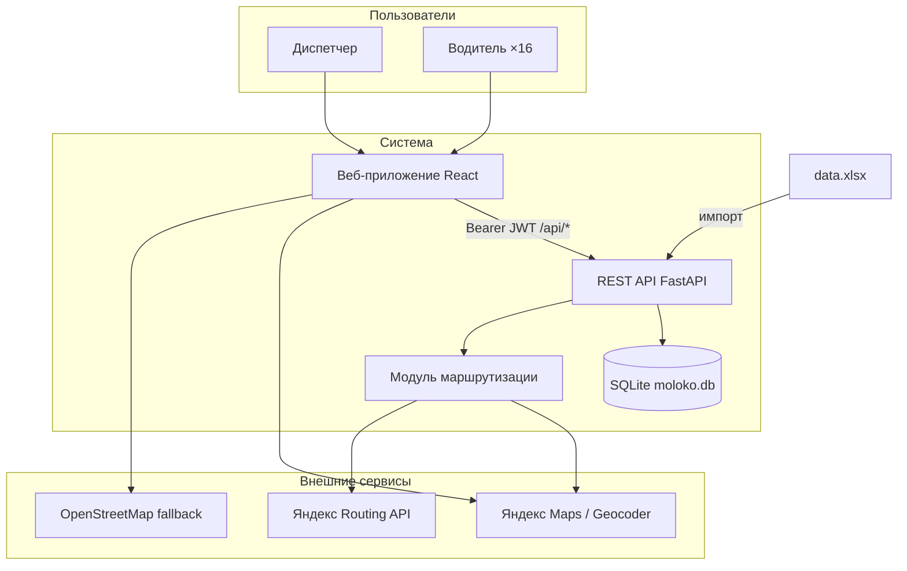
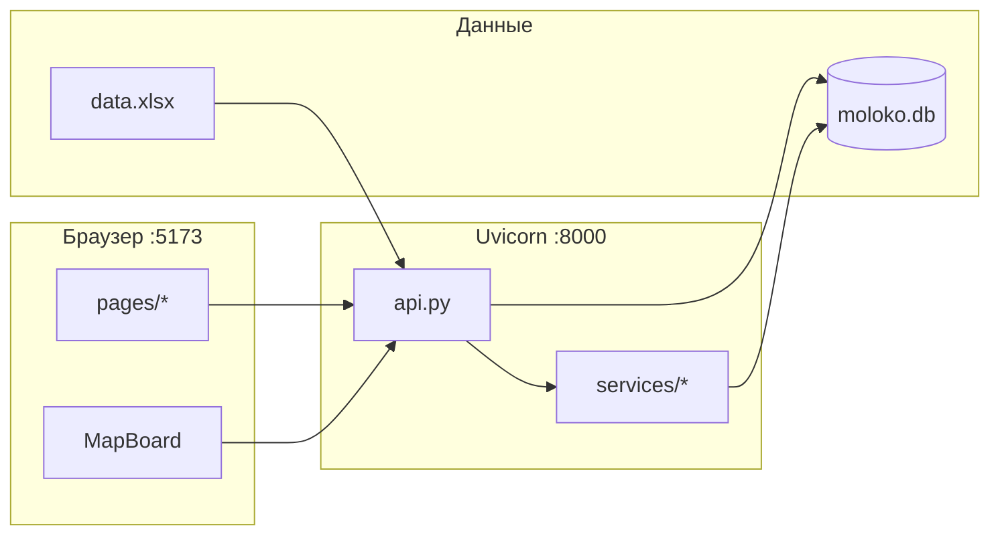
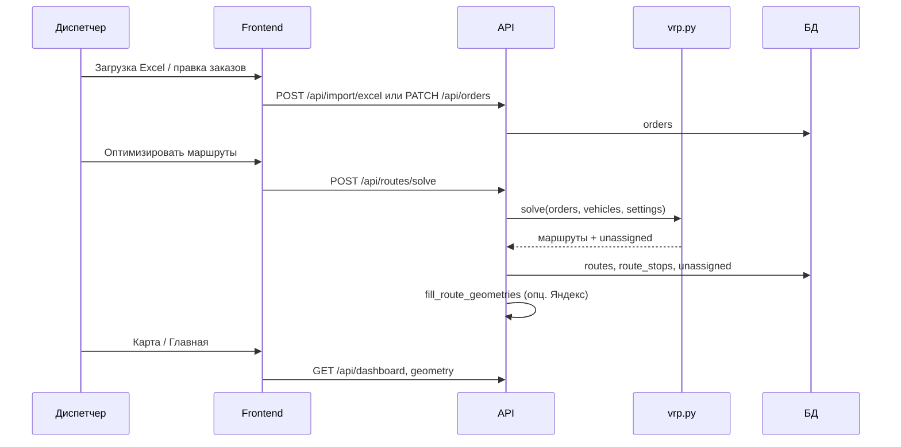
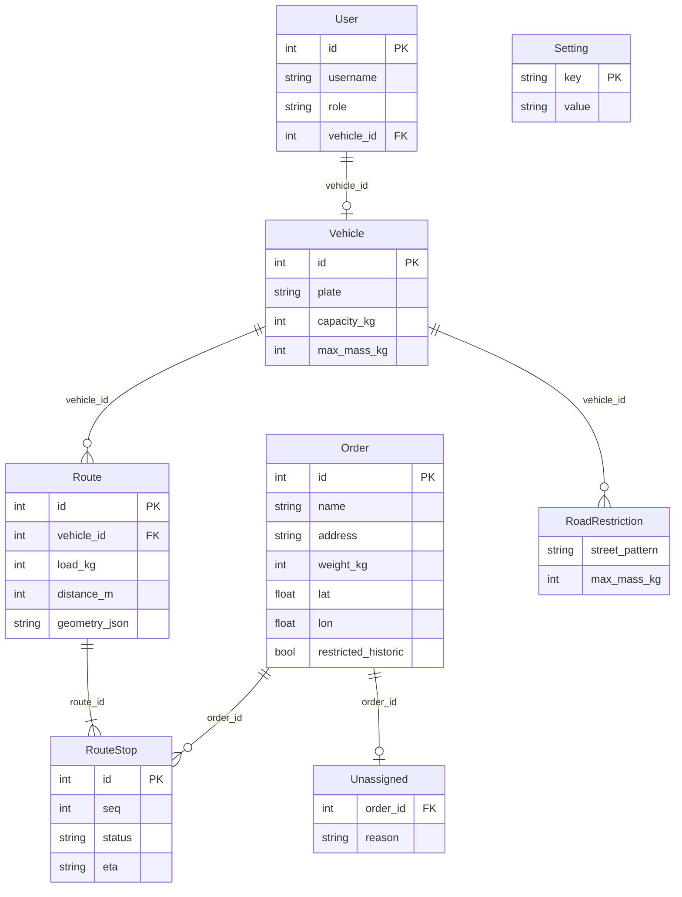

# Кодекс проекта: ОАО «Молочный мир» — логистика (Гродно)

Система распределения торговых точек по автопарку: VRP с грузоподъёмностью, минимальной загрузкой, окнами доставки, сменой 8 часов и ограничениями исторического центра для машин тяжелее 1,5 т.

---

## 1. Контекст (кто с чем работает)



| Роль | Логин (демо) | Интерфейс |
|------|----------------|-----------|
| Диспетчер | `dispatcher` / `dispatcher` | Все разделы с боковым меню |
| Водитель | `driver1`…`driver16` / `driver` | `/driver` — маршрут и статусы точек |

---

## 2. Структура репозитория

```
ProjectXakaton/
├── backend/app/           # Сервер
│   ├── main.py            # Точка входа FastAPI, startup (БД, seed, Excel)
│   ├── api.py             # Все HTTP-маршруты /api/*
│   ├── auth.py            # JWT, роли dispatcher | driver
│   ├── models.py          # SQLAlchemy-сущности
│   ├── serialize.py       # DTO для ответов API
│   ├── config.py          # .env, пути, ключи Яндекса
│   ├── database.py        # Engine, SessionLocal
│   ├── seed.py            # Начальные пользователи, машины, ограничения
│   ├── migrate.py         # Лёгкие миграции схемы
│   └── services/
│       ├── vrp.py         # CVRPTW: OR-Tools или встроенный солвер
│       ├── excel_import.py
│       ├── geo.py         # Депо, геокодинг, historic-флаги
│       ├── yandex.py      # HTTP к API Яндекса
│       ├── restrictions.py
│       ├── routing_geometry.py  # Полилинии маршрутов
│       └── costs.py       # Пробег, ФОТ, сводная экономика
├── frontend/src/          # Клиент (Vite + React 19)
│   ├── App.tsx            # Роутинг и gate по ролям
│   ├── Layout.tsx         # Оболочка диспетчера
│   ├── api.ts             # fetch + токен localStorage
│   ├── MapBoard.tsx       # Карта (Яндекс / Leaflet OSM)
│   ├── yandexMaps.ts
│   └── pages/             # Экраны
├── data.xlsx              # Исходные заказы (при первом старте)
├── requirements.txt
├── start.ps1              # API :8000 + frontend :5173
└── .env                   # Ключи Яндекса, SECRET_KEY (опционально)
```

---

## 3. Контейнеры и поток данных



### Типовой сценарий диспетчера



---

## 4. Модель данных



**Статусы остановки (`RouteStop.status`):** `pending` → `enroute` → `done` | `problem`.

---

## 5. Карта API (`/api`)

Полная интерактивная документация: http://127.0.0.1:8000/docs

| Группа | Методы | Назначение |
|--------|--------|------------|
| **Auth** | `POST /auth/login`, `GET /me` | Вход, текущий пользователь |
| **Сводка** | `GET /config`, `GET /dashboard`, `GET /analytics` | KPI, карта, отчёты |
| **Маршруты** | `POST /routes/solve`, `POST /routes/reassign`, `POST /routes/{id}/rebuild`, `GET /routes/{id}/geometry` | Пересчёт VRP, переназначение, геометрия |
| **Заказы** | `GET/POST/PATCH/DELETE /orders`, `POST /import/excel` | CRUD, Excel preview/импорт |
| **Автопарк** | `GET/POST/PATCH/DELETE /vehicles`, `GET /vehicles/{id}` | 16 машин, карточка |
| **Ограничения** | `GET/POST/PATCH/DELETE /restrictions`, `GET /feasibility` | Улицы, масса, габариты |
| **Настройки** | `GET /settings` | Депо, константы смены (таблица `settings`) |
| **Водитель** | `GET /driver/route`, `POST /driver/stops/{id}/start\|arrive\|done\|problem` | Мобильный сценарий |
| **Служебное** | `GET /health` (в `main.py`) | Проверка живости API |

Защита: большинство эндпоинтов диспетчера — `require_dispatcher`; водительские — привязка к `user.vehicle_id`.

---

## 6. Карта фронтенда (маршруты React)

| URL | Компонент | Роль | Основные API |
|-----|-----------|------|--------------|
| `/login` | `Login.tsx` | все | `POST /auth/login` |
| `/` | `Dispatcher.tsx` | dispatcher | `dashboard`, `routes/solve` |
| `/map` | `MapRoutes.tsx` + `MapBoard.tsx` | dispatcher | `dashboard`, geometry |
| `/orders` | `Orders.tsx` | dispatcher | `orders`, import |
| `/vehicles` | `Vehicles.tsx` | dispatcher | `vehicles` |
| `/vehicles/:id` | `VehicleCard.tsx` | dispatcher | `vehicles/{id}` |
| `/restrictions` | `Restrictions.tsx` | dispatcher | `restrictions` |
| `/analytics` | `Analytics.tsx` | dispatcher | `analytics` |
| `/settings` | `Settings.tsx` | dispatcher | `settings` |
| `/driver` | `Driver.tsx` | driver | `driver/route`, stops |

**Общие модули:** `api.ts` (JWT), `statusLabels.ts`, `driverFormat.ts`, `streetPatternLabel.ts`, `Logo.tsx`.

Прокси Vite шлёт `/api` на `http://127.0.0.1:8000` (см. `frontend/vite.config`).

---

## 7. Ядро алгоритма (`services/vrp.py`)

| Ограничение | Реализация |
|-------------|------------|
| Вместимость | `capacity_kg` на машину |
| Мин. загрузка ~90% | Штраф / отсечение в солвере |
| Смена 8 ч | `duration_s` + настройки |
| Окна доставки | `window_start` / `window_end`, `preferred_time` |
| Центр Гродно >1,5 т | `restricted_historic` на заказе + только лёгкие ТС |
| Доп. улицы | `RoadRestriction` + `restrictions.py` |
| Матрица расстояний | Яндекс Routing или haversine × коэффициент + пробки по часам |
| Движок | **OR-Tools** (если установлен) иначе встроенный **CVRPTW** |

Точка входа пересчёта: `run_solver` / `POST /routes/solve` в `api.py` → `persist_solution`.

---

## 8. Конфигурация

| Переменная | Файл | Назначение |
|------------|------|------------|
| `YANDEX_MAPS_API_KEY` | `.env` | JS API карт, геокодер |
| `YANDEX_ROUTING_API_KEY` | `.env` | Матрица / полилинии |
| `SECRET_KEY` | `.env` | JWT |
| `DATABASE_URL` | `.env` | По умолчанию SQLite в корне |

Без ключей Яндекса карта диспетчера работает на **OpenStreetMap**; маршруты — **городская модель** расстояний.

---

## 9. Запуск и артефакты

```powershell
python -m pip install -r requirements.txt
cd frontend && npm install && cd ..
.\start.ps1
```

- UI: http://localhost:5173  
- API: http://127.0.0.1:8000  
- БД: `moloko.db` (создаётся при старте, seed + импорт `data.xlsx` если пусто)

---

## 10. Где что искать при доработке

| Задача | Смотреть |
|--------|----------|
| Новый REST-метод | `backend/app/api.py` + `serialize.py` |
| Правило маршрутизации | `services/vrp.py`, `restrictions.py` |
| Импорт Excel | `services/excel_import.py` |
| Отображение на карте | `MapBoard.tsx`, `yandexMaps.ts` |
| Новый экран | `frontend/src/pages/`, маршрут в `App.tsx`, пункт в `Layout.tsx` |
| Демо-пользователи | `seed.py` |
| Стоимость рейса / аналитика | `services/costs.py`, `Analytics.tsx` |

---

*Документ сгенерирован как карта кодекса репозитория; при изменении API сверяйтесь с `/docs` и `api.py`.*